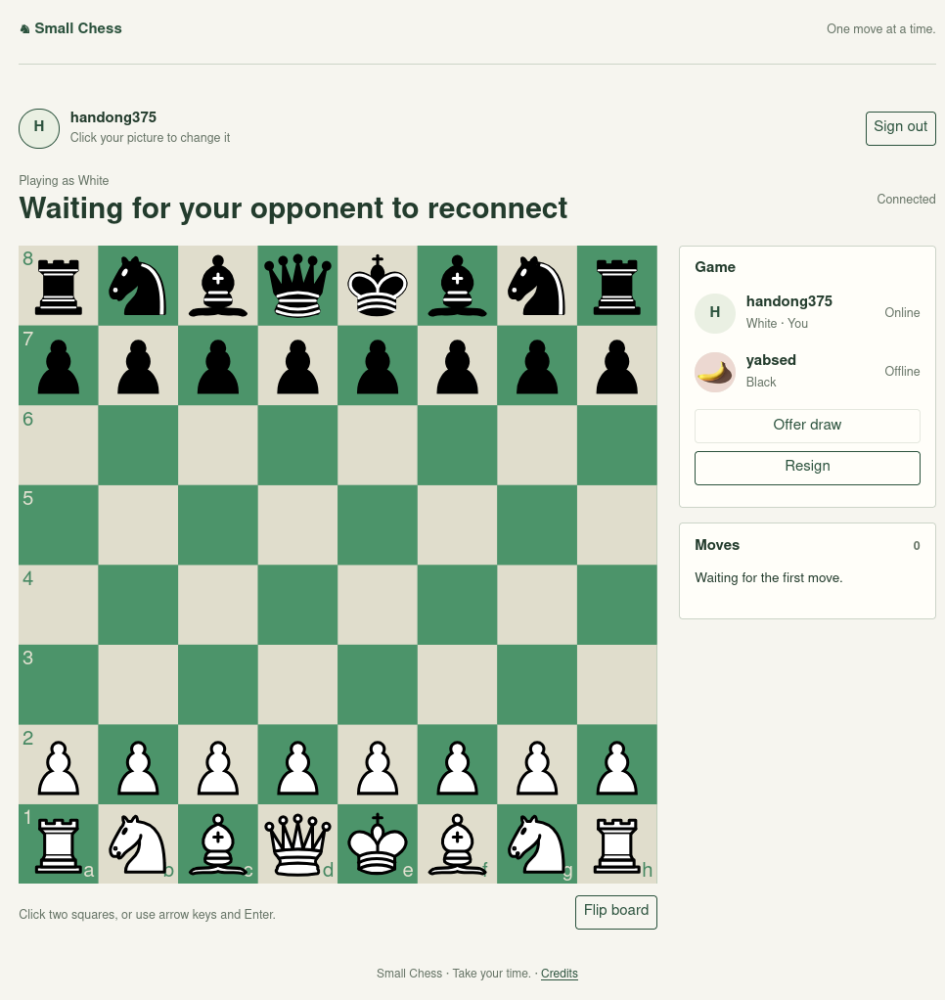

# Small Chess

Play chess in your browser. Find an opponent or invite a friend.

**[Play chess → https://yabsed.github.io/chess/](https://yabsed.github.io/chess/)**

## Get started

1. Click **Create an account** and choose a username and password.
2. Click **Find opponent** to match with another waiting player.
3. Select a piece, then its destination. You can also use the arrow keys and Enter.

To play with a friend, click **Invite a friend** and share the link. Your friend signs in and clicks **Join as Black** to start.

## Good to know

- Click your profile picture to upload a JPEG, PNG or WebP image up to 2 MiB.
- Use **Flip board** to change your view or **Offer draw** to propose a draw.
- Reload to return to your game. Sign in again after closing the tab.
- Games have no time limit. If your opponent disconnects, wait for them to reconnect.
- Games in progress reset when the server restarts.

[Report an issue](https://github.com/yabsed/chess/issues) · [Credits and licenses](apps/frontend/public/third-party-notices.txt)
