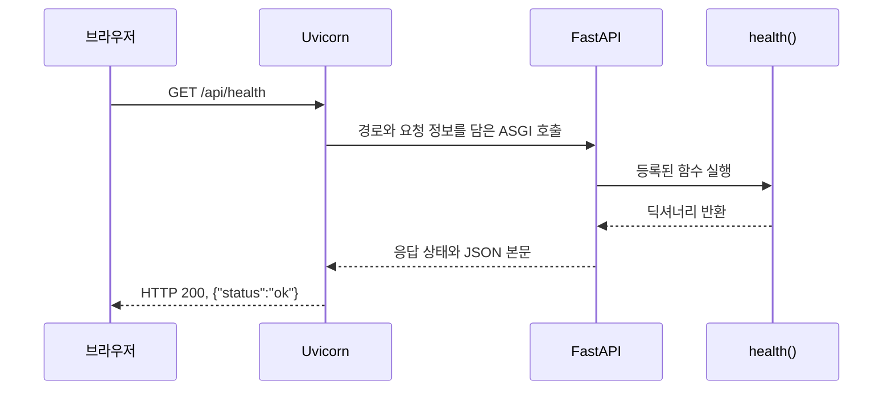
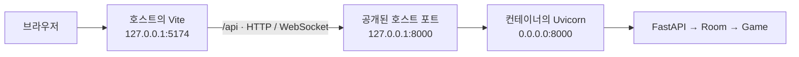

# 01. 백엔드의 실행과 Docker

프로젝트 루트에서 `make backend`를 실행하면 서버가 시작된다. 이 한 줄이 성립하려면 몇 가지 조건이 맞아야 한다. Python이 필요한 패키지를 찾을 수 있어야 하고, 실행할 애플리케이션의 위치를 알아야 하며, 브라우저의 요청을 받을 주소도 정해져 있어야 한다.

이 글은 그 조건들이 우리 코드에서 어떻게 마련되는지 살펴본다. 먼저 로컬 실행을 따라가고, 같은 애플리케이션을 Docker로 실행할 때 파일과 프로세스, 네트워크가 어떻게 달라지는지 설명한다. 설명의 기준은 이 프로젝트의 Linux 개발 환경이다.

Docker 설정은 `4ded391` (`build: add Docker support for the backend`)에서 추가됐다. 커밋 제목을 정리하기 전의 해시는 `264ffe5c80f6614267592adce38c6e071a6e9d61`이다. 이 커밋은 실행 설정을 추가했으며 Python 애플리케이션 코드는 바꾸지 않았다.

## 1. 로컬 명령이 실행 환경을 준비하는 과정

### 1.1 파일과 프로세스

`main.py`는 디스크에 저장된 텍스트 파일이다. 파일이 존재하는 것만으로는 요청을 받거나 체스판을 갱신하지 않는다. Python이 이 파일을 읽고 명령을 수행해야 한다.

운영체제가 실행 중인 프로그램에 부여하는 실행 단위를 프로세스라고 한다. 프로세스에는 식별 번호인 PID, 사용할 메모리, 열린 파일과 네트워크 연결 등의 상태가 있다. 우리 백엔드가 실행되면 Python 프로세스의 메모리에 FastAPI 객체와 대국 목록이 만들어진다.

디스크의 코드와 실행 중인 상태는 수명이 다르다. 서버를 종료해도 `main.py`는 남지만, 그 프로세스의 메모리에 있던 대국은 사라진다. 이 구분은 뒤에서 컨테이너의 종료를 설명할 때도 그대로 적용된다.

### 1.2 Make가 실행하는 명령

[Makefile](../Makefile)에는 다음 항목이 있다.

```makefile
backend:
	uv run --directory apps/backend uvicorn app.main:app --reload --ws-max-size 4096
```

`backend`는 Make가 실행할 작업의 이름이며, 이를 target이라고 부른다. 터미널에서 `make backend`를 입력하면 Make가 이 항목을 찾아 아래의 명령을 셸에 실행시킨다. 셸은 `zsh`나 `sh`처럼 명령을 해석하고 프로그램을 시작하는 도구다. Makefile의 명령 줄 앞에는 탭이 들어간다.

우리 Makefile은 `backend`를 `.PHONY`에도 등록한다. Make는 일반적으로 파일의 존재와 수정 시각을 보고 작업이 필요한지 판단하는데, `.PHONY`는 이 이름을 실행할 작업으로 취급하게 한다. 따라서 저장소에 `backend`라는 파일이 생겨도 서버 실행을 건너뛰지 않는다.

이어지는 명령은 두 부분으로 읽을 수 있다.

```text
uv run --directory apps/backend     실행할 환경과 위치를 준비한다.
uvicorn app.main:app ...            그 환경에서 서버를 시작한다.
```

`--directory apps/backend`는 uv의 작업 디렉터리를 바꾼다. 작업 디렉터리는 상대 경로를 해석하는 기준 위치다. 이 명령 이후 실행되는 프로그램에서 `app/main.py`라고 쓰면 저장소의 `apps/backend/app/main.py`를 가리킨다.

### 1.3 가상환경과 의존성

우리 코드가 사용하는 FastAPI, Uvicorn, python-chess는 별도로 설치하는 Python 패키지다. 프로그램이 실행되기 위해 필요한 이런 외부 패키지를 의존성이라고 부른다.

한 컴퓨터에서 여러 프로젝트를 개발하면 프로젝트마다 필요한 패키지 버전이 다를 수 있다. Python의 가상환경은 프로젝트별 Python 실행 경로와 패키지 설치 위치를 마련한다. 우리 프로젝트에서는 `apps/backend/.venv`가 그 디렉터리다. 그 안에는 Python 실행 파일 또는 원본 Python을 가리키는 링크, 설치된 패키지와 명령들이 있다. [Python의 가상환경](https://docs.python.org/3/library/venv.html)

uv는 이 환경을 준비하고 관리한다. 다음 세 항목은 역할이 다르다.

| 항목 | 담고 있는 것 |
|---|---|
| `pyproject.toml` | 프로젝트 정보와 허용하는 의존성 버전 범위 |
| `uv.lock` | 그 조건을 해결해 선택한 패키지 버전과 배포 파일 정보 |
| `.venv/` | 실제로 설치된 Python 실행 환경과 패키지 |

예를 들어 [pyproject.toml](../apps/backend/pyproject.toml)의 `fastapi>=0.115,<1`은 FastAPI 0.115 이상, 1 미만을 허용한다는 뜻이다. 실제 설치할 버전은 lockfile에 기록된다. 패키지 이름과 조건을 적는 일, 설치할 버전을 확정하는 일, 파일을 설치하는 일이 나뉘어 있는 셈이다.

`uv run`은 명령을 실행하기 전에 프로젝트 환경을 확인하고 필요하면 동기화한다. 이후 가상환경에 설치된 `uvicorn`을 실행할 수 있게 한다. 우리가 터미널에서 가상환경 활성화 명령을 먼저 입력하지 않아도 되는 이유다. [uv의 명령 실행](https://docs.astral.sh/uv/concepts/projects/run/)

현재 `make backend`에는 `--locked`가 없다. 따라서 의존성 설정을 바꾸면 uv가 lockfile도 갱신할 수 있다. 반면 뒤에서 볼 Docker 빌드는 `--locked`를 사용한다. 그 경우 lockfile 갱신이 필요하면 설치를 중단하므로, 빌드 중 의존성 선택이 바뀌는 것을 막는다. [잠금과 환경 동기화](https://docs.astral.sh/uv/concepts/projects/sync/)

### 1.4 `uvicorn`이라는 명령의 실체

패키지 설치는 Python에서 import할 파일뿐 아니라 터미널에서 실행할 명령도 만들 수 있다. Uvicorn을 설치하면 `.venv/bin/uvicorn`이라는 진입 스크립트가 생긴다. 이 스크립트는 `uvicorn.main.main`을 호출해 명령줄 인자를 처리한다.

스크립트의 첫 줄은 `#!`로 시작하며, 실행에 사용할 Python의 경로를 적는다. 이 줄을 shebang이라고 한다. 우리 로컬 환경에서는 해당 `.venv`의 Python을 가리킨다. 따라서 `uvicorn`을 실행했을 때 그 패키지를 설치한 환경의 Python이 선택된다.

여기까지의 역할은 다음과 같이 연결된다. 화살표는 실행을 맡기는 순서다.

```text
make backend
    → Makefile의 명령 실행
    → uv가 apps/backend/.venv 준비
    → 그 환경의 Python으로 Uvicorn 실행
```

## 2. Uvicorn이 FastAPI 객체를 찾는 과정

### 2.1 `app.main:app`이 가리키는 위치

Uvicorn은 웹 요청을 받아 Python 애플리케이션에 전달하는 서버 프로그램이다. 따라서 시작할 때 어떤 애플리케이션을 실행할지 알려줘야 한다. 그 정보가 `app.main:app`이다.

이 문자열의 콜론 앞뒤는 역할이 다르다.

```text
app.main : app
────────   ───
모듈 이름   그 모듈 안의 객체 이름
```

Python에서 모듈은 import해서 사용할 수 있는 코드 단위다. 우리 코드에서는 `main.py` 한 파일이 모듈이고, 이를 담은 `app` 디렉터리는 패키지다. 작업 디렉터리 아래에는 다음 구조가 있다.

```text
apps/backend/                 ← 작업 디렉터리
└── app/                      ← app 패키지
    ├── __init__.py
    ├── main.py               ← app.main 모듈
    ├── room.py
    └── game.py
```

Uvicorn은 기본적으로 현재 작업 디렉터리를 Python의 모듈 탐색 경로에 넣는다. 앞서 uv가 작업 디렉터리를 `apps/backend`로 정했으므로 `app.main`을 찾을 수 있다. 이 과정을 Python 코드로 줄이면 다음과 같다.

```python
module      = importlib.import_module("app.main")
application = getattr(module, "app")
```

첫 줄은 `app.main`을 import한다. 두 번째 줄은 가져온 모듈에서 `app`이라는 속성을 읽는다. 앞의 `app`은 디렉터리 이름이고, 콜론 뒤의 `app`은 Python 변수 이름이다. 우리 코드에서 같은 이름을 썼지만 각각 따로 해석된다.

### 2.2 import할 때 실행되는 것

[main.py](../apps/backend/app/main.py)를 처음 import하면 파일의 최상위 문장들이 실행된다. 다음 문장은 FastAPI 객체를 만들고 `app`이라는 변수에 저장한다.

```python
app = FastAPI(title = "Small Chess")
```

FastAPI 객체는 어떤 요청을 어떤 함수로 처리할지 알고 있다. 그 연결을 등록하는 코드가 다음 데코레이터다.

```python
@app.get("/api/health")
async def health():
    return {"status": "ok"}
```

이 코드를 import하는 시점에는 함수 객체를 만들고, GET 방식의 `/api/health` 요청을 `health`에 연결한다. 요청 방식과 경로에 따라 처리 함수를 고르는 규칙을 route라고 부른다. `return` 문은 나중에 실제 요청이 들어와 함수가 실행될 때 수행된다.

같은 import 과정에서 방 생성, 참가, WebSocket 경로도 등록된다. `rooms: dict[str, Room] = {}`는 빈 대국 목록을 프로세스 메모리에 만든다. 아직 사용자가 방을 만들지 않았으므로 내용은 없다.

Uvicorn이 요청 처리에 사용할 객체는 이렇게 준비된다. 다음으로 살펴볼 것은 네트워크로 도착한 요청이 이 객체에 전달되는 과정이다.

## 3. 브라우저의 요청이 함수에 도달하는 과정

### 3.1 주소, 포트, 소켓

백엔드가 실행된 상태에서 다음 주소를 열면 상태 확인 응답을 받을 수 있다.

```text
http://127.0.0.1:8000/api/health
```

각 부분은 서로 다른 단계에서 사용된다.

| 부분 | 의미 |
|---|---|
| `http` | 요청과 응답에 사용할 통신 규약 |
| `127.0.0.1` | 접속 대상의 IP 주소. 여기서는 자기 컴퓨터를 뜻하는 loopback 주소 |
| `8000` | 그 주소에서 접속할 TCP 포트 번호 |
| `/api/health` | 서버에 전달할 요청 경로 |

IP 주소는 통신할 대상을 지정하고, 포트는 그 대상에서 어느 통신 끝점으로 연결할지 지정한다. 운영체제가 프로그램에 제공하는 통신 끝점을 소켓이라고 한다. Uvicorn은 소켓을 만들고 주소와 포트를 지정한 뒤 연결을 기다린다. 이때 주소를 지정하는 동작을 bind, 들어오는 연결을 기다리는 동작을 listen이라고 부른다.

우리 로컬 실행 명령은 `--host`와 `--port`를 생략한다. 별도 환경변수 설정이 없다면 Uvicorn의 기본값인 `127.0.0.1:8000`을 사용한다. 브라우저가 이 주소로 TCP 연결을 만들면 Uvicorn이 연결을 받아 HTTP 요청을 읽는다. TCP는 두 프로그램 사이에서 바이트를 순서대로 전달하는 통신 방식이며, HTTP는 그 위에서 요청과 응답의 형식을 정한다.

`/api/health`와 `/api/games`는 같은 8000번 포트로 들어온다. 연결을 받은 뒤 FastAPI가 경로를 보고 처리 함수를 고른다. 요청 경로마다 별도의 수신 포트가 필요한 것은 아니다.

### 3.2 Uvicorn과 FastAPI 사이의 약속

네트워크로 들어온 바이트를 Python 코드에 어떻게 전달할지도 정해져 있어야 한다. Uvicorn과 FastAPI는 ASGI라는 호출 규약을 사용한다. 이는 웹 서버가 애플리케이션을 호출할 때 전달할 인자와 메시지 형식을 정한 약속이다.

호출의 기본 형태는 다음과 같다. 여기서 `application`은 앞서 가져온 FastAPI 객체다.

```python
await application(scope, receive, send)
```

`scope`는 요청 종류, 경로, 헤더 같은 정보를 담은 딕셔너리다. `receive`는 요청 본문이나 WebSocket 메시지를 받는 함수이고, `send`는 응답을 서버로 돌려주는 함수다. 앞의 `await`는 이 비동기 호출의 완료를 기다린다는 뜻이다. 기다리는 동안 다른 작업이 실행되는 방식은 다음 절에서 살펴본다. [ASGI 명세](https://asgi.readthedocs.io/en/latest/specs/main.html)

Uvicorn과 FastAPI는 같은 Python 서버 프로세스 안에서 객체와 함수를 호출한다. 이 호출에는 별도의 네트워크 접속이 필요하지 않다. Uvicorn이 통신 형식을 처리하고, FastAPI가 등록된 경로와 요청 검증 규칙을 적용한다.

GET `/api/health`가 도착하면 FastAPI는 `health()`를 실행한다. 함수가 반환한 딕셔너리는 JSON 형식의 응답 본문으로 바뀐다. JSON은 객체와 배열, 문자열 등을 텍스트로 표현하는 형식이다. 이 변환을 직렬화라고 부른다. Uvicorn은 응답 상태와 본문을 받아 소켓으로 보낸다.



서버는 이 응답을 보낸 뒤에도 다음 요청을 기다린다. `make backend`를 실행한 터미널이 곧바로 새 명령을 받지 않는 것은 서버 프로세스가 계속 실행 중이기 때문이다.

### 3.3 WebSocket과 비동기 처리

방 생성과 참가에는 HTTP 요청을 사용한다. 대국 중에는 상대가 수를 둘 때마다 서버가 새 상태를 보내야 하므로 WebSocket을 사용한다. WebSocket은 연결을 유지하면서 양쪽이 메시지를 보낼 수 있는 통신 규약이다.

브라우저가 연결을 요청하면 [main.py의 `play()`](../apps/backend/app/main.py)가 `socket.accept()`로 수락한다. 이어서 첫 메시지의 토큰을 검증한다. 토큰은 해당 플레이어의 자리를 확인하는 값이다. 인증을 마치면 연결별로 메시지를 기다리는 반복문에 들어간다. 그 안의 핵심 두 줄은 다음과 같다.

```python
message = await socket.receive_text()
still_connected = await room.handle(color, socket, message)
```

`async def`로 정의한 함수를 호출하면 실행을 잠시 멈췄다가 이어갈 수 있는 코루틴 객체를 얻는다. 위 코드에서 아직 메시지가 없다면 `await socket.receive_text()`가 그 연결의 처리를 대기시킨다. Uvicorn이 실행한 이벤트 루프는 이런 작업들을 관리하며, 대기 조건이 풀린 작업을 다시 실행한다. 백의 메시지를 기다리는 동안 흑의 메시지나 다른 방의 요청을 처리할 수 있다. [Python의 코루틴과 작업](https://docs.python.org/3.13/library/asyncio-task.html)

백이 `e2`의 폰을 `e4`로 옮기면 브라우저는 이동 명령을 보낸다. [Room.handle()](../apps/backend/app/room.py)은 메시지 형식, 대국 상태의 버전 번호인 `revision`, 참가자의 접속 상태를 검사한다. 이어서 [Game.apply()](../apps/backend/app/game.py)가 차례와 합법적인 수인지 확인한다. 수가 적용되면 `Room._broadcast()`가 변경된 상태를 두 플레이어에게 보낸다.

각 연결의 처리 흐름은 분리되어 있지만, 같은 방의 플레이어들은 하나의 `Room` 객체를 사용한다. 방 안의 `asyncio.Lock`은 잠금을 얻은 작업 하나만 검증·상태 변경·전송을 진행하게 한다. 전송을 기다리는 동안 다른 작업이 실행되더라도, 그 방의 다음 명령은 잠금이 풀릴 때까지 기다린다.

비동기 처리는 대기 시간을 다른 작업에 쓸 수 있게 한다. 체스 규칙 검사처럼 대기 없이 수행하는 계산은 그대로 이벤트 루프의 시간을 사용한다. 현재 코드는 그 계산을 별도 스레드나 프로세스로 옮기지 않는다.

실행 명령의 `--ws-max-size 4096`은 수신할 WebSocket 메시지 하나의 크기를 4,096바이트로 제한한다. 메시지 크기는 Uvicorn에서, 그 안에 담긴 명령의 유효성은 애플리케이션에서 검사한다.

### 3.4 코드를 고치면 서버가 다시 시작되는 이유

로컬 실행 명령에는 `--reload`가 있다. Uvicorn은 파일 변경을 감시하는 부모 프로세스와 요청을 처리하는 서버 자식 프로세스를 둔다. 부모가 마련한 소켓을 자식이 사용하며, 변경을 감지하면 서버 프로세스를 다시 시작한다.

새 서버 프로세스는 `app.main`을 다시 import한다. 따라서 FastAPI 객체와 빈 `rooms` 딕셔너리를 다시 만든다. 개발 중 코드를 고쳤을 때 대국이 사라지는 이유는 서버 메모리가 새로 만들어지기 때문이다.

## 4. Docker로 준비하는 실행 환경

### 4.1 가상환경에서 컨테이너로 범위를 넓히기

앞에서 사용한 `.venv`는 Python 패키지를 구분해 설치하는 수단이다. 그 Python은 여전히 컴퓨터에 설치된 시스템 라이브러리와 운영체제의 기능을 사용한다. 파일 경로와 네트워크도 컴퓨터의 환경을 따른다.

Docker를 사용하면 애플리케이션 코드, Python, 패키지, 필요한 시스템 파일을 함께 준비하고, 그 파일들을 사용하는 프로세스에 별도의 파일시스템과 네트워크 범위를 제공할 수 있다. 이때 컨테이너를 실행하는 컴퓨터를 호스트라고 부른다. 이 프로젝트에서는 개발 중인 Linux 컴퓨터가 호스트다.

먼저 세 용어를 구분할 필요가 있다.

| 용어 | 우리 프로젝트에서의 의미 |
|---|---|
| Dockerfile | 실행에 필요한 파일과 기본 설정을 만드는 절차를 적은 파일 |
| 이미지 | 그 절차의 결과로 마련한 파일들과 실행 설정의 묶음 |
| 컨테이너 | 이미지를 바탕으로 만든 개별 실행 환경. 실행 중에는 그 안의 프로세스가 동작한다. |

이미지에는 Python과 우리 코드가 들어 있고, 시작할 명령도 기록되어 있다. 이 자체는 요청을 처리하지 않는다. 컨테이너를 만들어 그 명령을 실행해야 서버 프로세스가 생긴다. 같은 이미지에서 여러 컨테이너를 만들 수도 있으며, 각각의 프로세스 메모리는 따로 마련된다. [이미지의 구성](https://docs.docker.com/get-started/docker-concepts/the-basics/what-is-an-image/)

우리 [Makefile](../Makefile)의 두 명령은 이 순서를 따른다.

```makefile
backend-docker:
	docker build -t chess-backend apps/backend
	docker run --rm --name chess-backend -p 127.0.0.1:8000:8000 chess-backend
```

`build`는 이미지를 만들고, `run`은 그 이미지로 새 컨테이너를 만들어 시작한다. Make는 첫 명령이 성공한 뒤 두 번째 명령을 실행한다. 이 프로젝트에서 빌드란 필요한 파일을 배치하고 의존성을 설치해 이미지를 만드는 작업이다.

### 4.2 이름과 빌드 컨텍스트

첫 명령의 `-t chess-backend`는 빌드 결과에 이름을 붙인다. 태그를 생략했으므로 기본 태그인 `latest`가 붙어 `chess-backend:latest`가 된다. `latest`는 여기서 사용하는 태그 이름이며, 언제나 최신 코드를 자동으로 가져온다는 뜻은 아니다.

완성된 이미지는 컨테이너 도구가 관리하는 로컬 이미지 저장소에 보관된다. 마지막 인자인 `apps/backend`는 빌드에 사용할 파일들의 기준 디렉터리다. 이 파일 범위를 빌드 컨텍스트라고 부른다. 기본적으로 Dockerfile도 이 디렉터리에서 찾는다. [빌드 컨텍스트](https://docs.docker.com/build/concepts/context/)

따라서 Dockerfile에 `COPY app ./app`이라고 쓰면 원본 `app`은 호스트의 `apps/backend/app`이다. 컨텍스트의 파일이 모두 자동으로 이미지에 들어가는 것은 아니다. Dockerfile의 `COPY`가 지정한 파일을 복사한다.

우리 [.dockerignore](../apps/backend/.dockerignore)는 로컬 `.venv`, Python 캐시, 테스트, `.env*`를 빌드 컨텍스트에서 제외한다. 특히 가상환경에는 그 환경을 만든 컴퓨터의 경로와 플랫폼에 맞는 파일이 들어 있으므로 컨테이너에서는 새로 만든다. 프런트 디렉터리인 `apps/frontend`는 애초에 이 컨텍스트 밖에 있다.

## 5. Dockerfile을 읽는 순서

[Dockerfile](../apps/backend/Dockerfile)의 전체 내용은 다음과 같다. 파일을 준비하는 명령과 나중의 실행을 위한 설정이 함께 들어 있다.

```dockerfile
FROM docker.io/library/python:3.13-slim-bookworm
COPY --from=ghcr.io/astral-sh/uv:0.11.16 /uv /bin/uv

WORKDIR /app
ENV PYTHONDONTWRITEBYTECODE=1 PYTHONUNBUFFERED=1

COPY pyproject.toml uv.lock ./
RUN uv sync --locked --no-dev --no-cache --no-install-project

COPY app ./app
USER 10001:10001

EXPOSE 8000
CMD [".venv/bin/uvicorn", "app.main:app", \
     "--host", "0.0.0.0", "--port", "8000", "--ws-max-size", "4096"]
```

### 5.1 Python과 uv를 가져오는 단계

`FROM`은 출발점으로 사용할 이미지를 정한다. `docker.io`는 이미지를 배포하는 저장소인 Docker Hub의 주소이고, `library/python`은 공식 Python 이미지의 이름이다. 이런 이미지 저장소를 레지스트리라고 부른다. 태그 `3.13-slim-bookworm`은 Python 3.13과 Debian Bookworm을 바탕으로 한 비교적 작은 구성을 지정한다. [Docker의 이미지 배포 구조](https://docs.docker.com/get-started/docker-overview/)

이 이미지에는 Python 실행 파일과 실행에 필요한 라이브러리, 기본 명령들이 들어 있다. 따라서 이미지 안의 Python으로 환경을 준비할 수 있다. Debian Bookworm은 Linux 배포판의 이름이며, 여기서는 Python과 함께 사용할 시스템 파일의 구성을 정한다.

다음 `COPY --from=...`은 다른 이미지에서 파일을 가져온다. 여기서는 `ghcr.io`에 배포된 uv 0.11.16 이미지의 `/uv`를 우리 이미지의 `/bin/uv`로 복사한다. 그 결과 다음 설치 단계에서 `uv` 명령을 사용할 수 있다.

### 5.2 작업 디렉터리와 환경변수

`WORKDIR /app`은 이후 명령을 실행할 위치를 `/app`으로 정한다. 이 경로는 이미지를 바탕으로 구성할 파일시스템 안의 경로다. 호스트의 프로젝트 디렉터리 이름과 같을 필요는 없다.

`COPY pyproject.toml uv.lock ./`에서는 원본과 목적지의 기준이 다르다. 원본은 호스트의 빌드 컨텍스트를 기준으로 읽고, 상대 목적지 `./`는 앞서 정한 `/app`을 기준으로 해석한다.

```text
호스트의 파일                         이미지 안의 파일
apps/backend/pyproject.toml    →     /app/pyproject.toml
apps/backend/uv.lock           →     /app/uv.lock
apps/backend/app/main.py       →     /app/app/main.py
```

마지막 경로는 뒤의 `COPY app ./app`으로 만들어진다. `/app/app`에서 앞의 `app`은 작업 디렉터리 이름이고, 뒤의 `app`은 우리 Python 패키지 이름이다.

환경변수는 프로세스가 시작할 때 전달받는 이름과 값의 설정이다. `ENV`는 이미지에서 실행할 프로세스에 적용할 기본값을 기록한다. 여기서는 Python이 읽는 두 값을 지정한다.

`PYTHONDONTWRITEBYTECODE=1`은 import한 코드를 다시 사용할 때 참고하는 `.pyc` 캐시 파일을 쓰지 않게 한다. `PYTHONUNBUFFERED=1`은 표준 출력과 오류 출력을 즉시 내보내게 한다. 이 두 출력은 프로그램이 로그와 메시지를 내보내는 통로다. 출력을 잠시 모아두는 버퍼를 거치지 않게 해서 로그가 터미널에 지연되어 나타나는 일을 줄인다. [Python의 환경변수](https://docs.python.org/3.13/using/cmdline.html)

### 5.3 의존성을 설치하고 코드를 넣는 단계

`RUN`은 이미지 빌드 중 명령을 실제로 실행한다. `RUN uv sync ...`에서는 `/app`의 프로젝트 설정을 읽고 `/app/.venv`를 만든 뒤 의존성을 설치한다. uv의 설치 프로세스는 작업이 끝나면 종료되고, 설치한 파일들이 이미지에 남는다.

| 옵션 | 이 빌드에서의 역할 |
|---|---|
| `--locked` | lockfile 갱신이 필요하면 빌드를 실패시킨다. |
| `--no-dev` | 테스트용 pytest, httpx2 등이 속한 `dev` 그룹을 설치하지 않는다. |
| `--no-cache` | uv의 영구 캐시를 사용하지 않는다. 임시 캐시는 작업 뒤 정리한다. |
| `--no-install-project` | 의존성은 설치하되 프로젝트 자체를 Python 패키지로 설치하는 단계는 생략한다. |

우리 코드는 이어지는 `COPY app ./app`으로 넣는다. Uvicorn이 작업 디렉터리에서 `app.main`을 import할 수 있으므로, 프로젝트 자체를 설치된 패키지 목록에 넣을 필요가 없다. 현재 `pyproject.toml`에도 프로젝트 패키지를 만드는 build system을 선언하지 않았다. [uv의 컨테이너 구성](https://docs.astral.sh/uv/guides/integration/docker/)

### 5.4 컨테이너가 시작할 때 사용할 설정

`USER 10001:10001`은 이후 실행할 프로세스의 사용자 번호와 그룹 번호를 정한다. Linux에서는 이를 UID와 GID라고 하며, 파일을 읽거나 쓸 수 있는 권한을 판단할 때 사용한다. 서버는 컨테이너 안에서 이 번호로 실행된다.

`EXPOSE 8000`은 이 이미지의 프로그램이 8000번 포트를 사용할 것이라는 정보를 기록한다. 소켓을 여는 일은 Uvicorn이 하고, 호스트에서 그 포트에 접근할 경로를 만드는 일은 뒤의 `docker run -p`가 맡는다.

`CMD`는 컨테이너를 시작할 때 사용할 기본 명령이다. 첫 항목이 실행 파일이고 나머지는 그 파일에 전달할 인자다. 위 배열을 실행 파일과 인자로 나누면 다음과 같다.

```text
실행 파일: .venv/bin/uvicorn
인자:      app.main:app --host 0.0.0.0 --port 8000 --ws-max-size 4096
```

`RUN`은 빌드 중 실행되고, `CMD`는 나중에 실행할 명령을 기록한다. 따라서 `docker build`만 끝난 시점에는 이미지가 준비되어 있고 체스 서버는 아직 시작하지 않았다. [Dockerfile 명령의 의미](https://docs.docker.com/reference/dockerfile/)

### 5.5 의존성을 코드보다 먼저 복사하는 이유

이미지는 파일시스템의 변경을 담은 계층들로 구성된다. 빌더는 명령과 입력이 같으면 이전 빌드 결과를 캐시에서 재사용할 수 있다. 캐시는 같은 작업을 다시 수행하지 않도록 저장해 둔 결과다. [이미지의 계층](https://docs.docker.com/get-started/docker-concepts/building-images/understanding-image-layers/)

우리 Dockerfile은 의존성 파일을 복사하고 패키지를 설치한 뒤에 소스를 복사한다. 따라서 기본 이미지와 의존성 설정이 같고 `main.py`만 바뀌었다면, 앞의 패키지 설치 결과를 재사용할 수 있다. `uv.lock`이 바뀌면 그 입력을 사용하는 설치 단계도 다시 수행한다.

여기에는 캐시가 두 종류 등장한다. `uv sync --no-cache`는 패키지 관리 도구인 uv의 캐시를 제어한다. Docker 빌더가 설치 결과 전체를 재사용하는 캐시는 그대로 사용할 수 있다.

버전을 고정하는 범위도 구분해야 한다. `uv.lock`은 Python 패키지의 선택을 기록하지만, 기본 이미지의 `3.13-slim-bookworm` 태그는 Python의 패치 버전까지 고정하지 않는다. 같은 태그가 나중에 갱신될 수 있다. 이미지 내용 자체를 식별하는 값은 digest라고 부르며, 현재 Dockerfile은 그 값으로 기본 이미지를 고정하지 않는다.

## 6. 컨테이너를 시작하고 연결하는 과정

### 6.1 `docker run`과 기본 명령

이미지가 준비되면 두 번째 명령을 실행한다.

```sh
docker run --rm --name chess-backend -p 127.0.0.1:8000:8000 chess-backend
```

마지막 `chess-backend`는 사용할 이미지의 이름이고, `--name chess-backend`는 새로 만드는 컨테이너의 이름이다. 두 이름이 같아도 대상은 다르다. 이후 `docker stop chess-backend`처럼 실행 중인 컨테이너를 지정할 때는 `--name`으로 붙인 이름을 사용한다.

이미지 뒤에 별도의 실행 명령을 적지 않았으므로 Dockerfile의 `CMD`가 적용된다. 작업 디렉터리는 `/app`이므로 실행 파일은 `/app/.venv/bin/uvicorn`이다. 그 스크립트의 shebang은 `/app/.venv/bin/python`을 가리킨다. 해당 Python이 Uvicorn을 실행하고, Uvicorn이 `/app/app/main.py`의 `app` 객체를 가져온다.

| 항목 | 로컬 실행 | 컨테이너 실행 |
|---|---|---|
| 작업 디렉터리 | `apps/backend` | `/app` |
| 가상환경 | `apps/backend/.venv` | `/app/.venv` |
| 모듈 파일 | `apps/backend/app/main.py` | `/app/app/main.py` |
| Uvicorn이 가져오는 객체 | `app.main:app` | `app.main:app` |

로컬 경로는 저장소 루트를 기준으로 적었다. 두 경우 모두 작업 디렉터리 아래에 `app/main.py`가 있으므로 같은 모듈 이름을 사용할 수 있다. 컨테이너 시작 시에는 이미 설치된 Uvicorn을 직접 실행하므로 uv로 설치 과정을 다시 거칠 필요가 없다.

현재 `run` 명령에는 백그라운드 실행 옵션인 `-d`가 없다. 터미널은 서버 출력을 보여주며 종료를 기다린다. `--rm`은 이 컨테이너가 종료되면 컨테이너를 자동으로 제거하라는 설정이다. 만들어 둔 이미지는 남는다. [컨테이너 실행](https://docs.docker.com/engine/containers/run/)

### 6.2 격리된 프로세스가 의미하는 것

컨테이너 안의 Python도 호스트의 CPU와 메모리를 사용한다. 프로세스 실행, 파일 접근, 네트워크 통신을 관리하는 운영체제의 핵심 부분을 커널이라고 한다. 이 Linux 환경의 컨테이너들은 호스트 커널을 공유한다. Dockerfile의 Debian 이미지는 프로그램과 라이브러리 같은 사용자 공간의 파일들을 제공한다. 컨테이너마다 별도의 커널을 부팅하지는 않는다. [컨테이너의 실행 구조](https://docs.docker.com/get-started/docker-concepts/the-basics/what-is-a-container/)

같은 커널을 쓰면서 서로 다른 범위를 볼 수 있게 하는 기능이 namespace다. 예를 들어 프로세스 번호를 보는 범위, 파일시스템의 연결을 보는 범위, 네트워크 인터페이스와 포트의 범위를 나눌 수 있다. 컨테이너에서 `/app`이라고 읽는 위치가 호스트의 `/app`과 다른 이유도 이 파일시스템 구성이 있기 때문이다.

CPU와 메모리 사용을 묶어서 관리하는 기능은 cgroup이라고 한다. 컨테이너 도구는 이런 커널 기능을 사용해 프로세스의 실행 환경을 마련한다. 우리 명령은 별도의 CPU·메모리 상한을 지정하지 않는다. [namespace와 cgroup](https://docs.docker.com/engine/security/)

Dockerfile의 `CMD`는 JSON 배열인 exec 형식이다. 중간에 명령을 해석할 셸을 두지 않고 지정한 실행 파일을 시작한다. 현재 이미지에서는 Uvicorn을 실행하는 Python이 컨테이너 안에서 PID 1이 된다. 호스트에서 이 프로세스를 볼 때의 PID는 다르다. Uvicorn은 종료 신호를 받으면 연결과 서버를 정리한다.

이 프로젝트에서 확인한 개발 환경의 `docker --version`은 `podman version 5.8.7`을 출력했다. 즉, 이 머신은 Docker와 호환되는 명령을 Podman으로 실행한다. 일반적인 Docker Engine은 백그라운드 관리 프로그램인 데몬에 작업을 요청하지만, Podman은 상주 Docker 데몬 없이 컨테이너를 관리한다. 파일과 실행 설정에 관한 앞의 설명은 그대로 적용되며, 내부 관리 주체는 구분해야 한다. [Podman의 실행 구조](https://docs.podman.io/en/latest/markdown/podman.1.html)

### 6.3 `0.0.0.0`과 두 개의 8000

로컬 Uvicorn은 `127.0.0.1:8000`에서 요청을 받았다. 컨테이너에서는 `--host 0.0.0.0 --port 8000`을 명시한다. 네트워크 범위가 나뉘었기 때문이다.

`127.0.0.1`은 자신이 속한 네트워크 공간의 loopback 주소다. 호스트에서 접속하는 `127.0.0.1`은 호스트 자신을 가리키고, 컨테이너 안에서 접속하는 `127.0.0.1`은 그 컨테이너의 네트워크 공간을 가리킨다. 주소의 글자가 같아도 범위가 다르다.

네트워크 인터페이스는 프로그램이 통신에 사용하는 접점이며, 그 인터페이스에 IP 주소가 연결된다. Uvicorn이 컨테이너의 loopback에만 소켓을 열면 다른 인터페이스로 들어온 연결은 받지 못한다. `0.0.0.0`에 bind한다는 것은 특정 주소 하나로 한정하지 않고 모든 로컬 IPv4 인터페이스에서 연결을 받겠다는 뜻이다. 여기서 그 범위는 컨테이너 내부다.

호스트에서 이 서버에 도달할 경로는 `-p 127.0.0.1:8000:8000`이 정한다. 콜론으로 구분한 세 값은 다음과 같다.

| 값 | 의미 |
|---|---|
| `127.0.0.1` | 호스트에서 공개할 주소 |
| 첫 번째 `8000` | 호스트에서 받을 포트 |
| 두 번째 `8000` | 연결을 전달할 컨테이너 포트 |

즉, 호스트의 `127.0.0.1:8000`으로 들어온 연결을 컨테이너의 8000번 포트로 전달한다. 컨테이너 도구가 이 전달 경로를 마련하고, 끝에서 Uvicorn이 연결을 받는다. Docker의 일반적인 bridge 네트워크는 주소를 변환하는 NAT와 방화벽 규칙을 사용한다. 전달의 내부 구현은 런타임과 네트워크 구성에 따라 다를 수 있다. [포트 공개와 매핑](https://docs.docker.com/engine/network/port-publishing/)

두 포트 번호는 같을 필요가 없다. `-p 127.0.0.1:9000:8000`으로 실행하면 브라우저는 호스트의 9000번 포트로 접속하고 Uvicorn은 여전히 컨테이너의 8000번 포트에서 받는다. 이 예에서 바뀌는 것은 호스트 쪽 접속 주소다.

따라서 컨테이너 내부의 `0.0.0.0`과 호스트에 공개할 주소는 따로 읽어야 한다. 현재 명령은 호스트 쪽 주소를 `127.0.0.1`로 지정한다. 컨테이너 안에서 모든 인터페이스를 수신한다고 해서 이 설정이 호스트의 모든 주소에 포트를 공개하는 것은 아니다.

### 6.4 프런트의 요청이 지나가는 경로

개발 중에는 `make frontend`로 Vite 서버를 실행하고 기본 주소인 `http://127.0.0.1:5174`에 접속한다. Vite는 브라우저에 프런트 코드를 제공하는 개발 서버다.

[api.ts](../apps/frontend/src/lib/api.ts)는 `/api/games`처럼 주소의 경로 부분만 적은 상대 URL을 사용한다. 브라우저는 현재 페이지의 주소를 기준으로 이를 해석하므로 요청은 먼저 5174번 포트의 Vite에 도착한다. WebSocket도 현재 페이지의 호스트와 포트를 뜻하는 `location.host`를 기준으로 연결한다.

[vite.config.ts](../apps/frontend/vite.config.ts)는 `/api`로 시작하는 요청을 `http://127.0.0.1:8000`으로 전달한다. 이렇게 요청을 받아 다른 서버에 대신 전달하는 역할을 프록시라고 부른다. 설정의 `ws: true`는 WebSocket 연결도 전달하게 한다.



Docker를 도입해도 Vite가 접속할 주소는 그대로다. 그래서 프런트 코드를 바꾸지 않고 백엔드 실행 방법을 교체할 수 있다. 반대로 앞의 예처럼 호스트 포트를 9000으로 바꾸면 Vite의 프록시 대상도 9000으로 맞춰야 한다.

컨테이너를 써도 호스트에서 사용할 포트는 필요하다. 로컬 백엔드가 이미 `127.0.0.1:8000`을 사용 중이라면 같은 주소로 컨테이너 포트를 공개할 수 없다. 현재 두 실행 방식은 같은 호스트 포트를 사용하므로 하나를 종료한 뒤 다른 하나를 실행한다.

## 7. 코드 변경과 대국 상태의 수명

### 7.1 파일을 고쳐도 실행 중인 컨테이너가 바뀌지 않는 이유

컨테이너의 파일시스템은 이미지의 읽기 전용 계층과 컨테이너별 쓰기 계층을 조합해 제공된다. 프로그램이 파일을 새로 만들거나 수정하면 그 컨테이너의 쓰기 계층에 기록된다. 같은 이미지를 사용하는 다른 컨테이너의 파일은 이 변경을 공유하지 않는다.

우리 소스는 빌드할 때 `COPY`로 이미지에 넣었다. 현재 실행 명령에는 호스트의 디렉터리를 컨테이너 안에 연결하는 bind mount가 없다. 따라서 호스트의 `main.py`를 수정해도 이미 복사한 컨테이너의 파일은 바뀌지 않는다.

Docker의 `CMD`에는 변경을 감시하는 `--reload`도 없다. 현재 구성에서 수정한 코드를 적용하려면 실행 중인 컨테이너를 종료하고 `make backend-docker`를 다시 실행한다. 변경된 파일로 이미지를 빌드하고 그 이미지에서 새 컨테이너를 시작하게 된다. 이미지를 새로 빌드하는 것만으로 기존 컨테이너의 실행 내용이 교체되지는 않는다.

### 7.2 종료 후 남는 것

대국은 `rooms` 딕셔너리와 그 안의 `Room`, `Game` 객체에 저장된다. 현재 코드는 이 상태를 파일이나 데이터베이스에 기록하지 않는다.

| 대상 | 현재 구성에서 저장되는 곳 | 서버 종료 후 |
|---|---|---|
| 애플리케이션 코드와 설치 패키지 | 이미지 | 남는다. |
| 컨테이너 실행 중 작성한 일반 파일 | 컨테이너의 쓰기 계층 | `--rm`으로 컨테이너를 제거하면 함께 사라진다. |
| 대국 목록과 체스판 상태 | Python 프로세스의 메모리 | 프로세스가 종료되면 사라진다. |

이 때문에 `--rm`을 빼도 대국은 복구되지 않는다. 컨테이너의 파일이 보존되는 것과 Python 메모리가 보존되는 것은 다르다. 같은 이미지를 다시 실행하면 새 프로세스가 `rooms = {}`부터 시작한다.

서버 프로세스나 컨테이너를 여러 개 실행해도 이 메모리는 자동으로 공유되지 않는다. 한 프로세스가 만든 방을 다른 프로세스는 알지 못하며, `asyncio.Lock`도 프로세스 사이를 동기화하지 않는다. 현재 명령은 요청을 처리하는 서버 프로세스 하나를 사용하는 저장 방식에 맞춰져 있다.

### 7.3 이 이미지에 프런트 화면이 없는 이유

`main.py`는 자신의 파일 위치를 기준으로 `frontend/dist` 경로를 계산하고, 그 디렉터리가 있을 때만 정적 파일 제공을 등록한다. 정적 파일은 브라우저가 내려받는 HTML, JavaScript, CSS 같은 파일이다. 프런트 빌드 결과가 여기에 해당한다.

로컬에서 이 경로는 `apps/frontend/dist`다. `make build`로 그 디렉터리를 만든 뒤 백엔드를 시작하면 FastAPI가 화면도 제공할 수 있다. 반면 현재 컨테이너에서 계산한 경로는 `/frontend/dist`이며 이미지에 이 디렉터리를 넣지 않았다. 따라서 이 이미지는 API와 WebSocket을 제공하고, 개발 중 화면은 앞서 설명한 Vite가 제공한다.

## 8. 설명을 실행 결과로 확인하기

호스트의 8000번 포트가 비어 있는 상태에서 프로젝트 루트의 터미널 하나에 다음 명령을 실행한다.

```sh
make backend-docker
```

먼저 이미지 빌드 로그가 나오고, 빌드가 성공하면 Uvicorn의 시작 로그가 이어진다. 빌드만 따로 확인하려면 `backend-docker` 항목의 첫 명령인 `docker build -t chess-backend apps/backend`만 실행하면 된다. 이 경우 이미지가 만들어진 뒤 명령이 끝난다.

서버를 실행한 터미널은 그대로 두고 다른 터미널에서 요청을 보낸다. `curl`은 터미널에서 HTTP 요청을 보내는 도구다.

```sh
curl http://127.0.0.1:8000/api/health
```

정상 실행 상태라면 응답 본문은 `{"status":"ok"}`다. 이 요청은 Vite를 거치지 않고 호스트의 공개 포트, 컨테이너의 Uvicorn, FastAPI의 `health()`를 차례로 지난다.

실행 중인 컨테이너는 다음 명령으로 확인할 수 있다.

```sh
docker ps --filter name=chess-backend
```

컨테이너의 이름, 사용한 이미지, 공개된 포트가 표시된다. 컨테이너 안의 작업 디렉터리도 확인할 수 있다.

```sh
docker exec chess-backend pwd
```

`exec`는 이미 실행 중인 컨테이너 안에서 추가 명령을 실행한다. `pwd`는 그 명령의 작업 디렉터리를 출력한다. 현재 설정에서는 `/app`이 나온다. 서버 프로세스는 그동안 계속 실행된다.

마지막으로 다음 명령은 Uvicorn에 종료 신호를 전달한다. 서버가 연결을 정리하고 종료하면 `--rm` 설정에 따라 컨테이너가 제거된다.

```sh
docker stop chess-backend
```

종료 뒤 `docker ps -a --filter name=chess-backend`에는 해당 컨테이너가 없고, `docker image ls chess-backend`에는 빌드한 이미지가 남아 있다. 프로세스와 컨테이너의 수명, 다시 실행할 때 사용할 이미지의 수명을 각각 확인할 수 있다.
