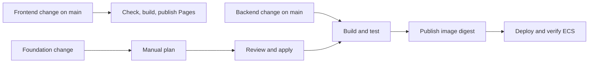

# Deployment

Choose the directory for the work you are doing:

| Directory | Change |
| --- | --- |
| [backend/](backend/) | Application image, ECS task and service |
| [foundation/](foundation/) | Network, traffic, database, compute and backend deployment permissions |
| [bootstrap/](bootstrap/README.md) | Infrastructure user's permissions and foundation execution role |

Each directory keeps its template beside the commands that use it. These templates
manage existing production resources; preserve their logical IDs. They are not an
empty-account installer. The database, its credentials and API-only deployment
users existed before CloudFormation adoption.

Workflows select when to run and which credentials to pass. Python programs hold
deployment state and make the checks and recovery decisions. CloudFormation YAML
declares the resources. The short `backend/smoke.sh` checks HTTP and WebSockets.



Pull requests run checks without AWS credentials. Backend and foundation writes
share a concurrency group. Foundation template changes do not start Backend on push;
the Infrastructure workflow calls Backend after a successful apply at the same
commit. If a change touches both, apply the foundation before releasing the backend.

## Settings

GitHub repository variables select the deployment target. The scripts check the
authenticated account against `AWS_ACCOUNT_ID` before reading deployment resources.

| Repository setting | Value |
| --- | --- |
| Secret `AWS_ACCESS_KEY_ID` / `AWS_SECRET_ACCESS_KEY` | Existing `chess-github-deploy` key pair |
| Secret `AWS_INFRA_ACCESS_KEY_ID` / `AWS_INFRA_SECRET_ACCESS_KEY` | Separate `chess-github-infra` key pair |
| Variable `AWS_DEPLOY_ENABLED` | `true` enables backend deployment |
| Variable `AWS_REGION` | Deployment region |
| Variable `AWS_ACCOUNT_ID` | Expected AWS account |
| Variable `FOUNDATION_STACK` | Existing foundation stack |
| Variable `BACKEND_STACK` | Backend stack, named `<ECS cluster>-backend` |
| Variable `FOUNDATION_ROLE` | Foundation CloudFormation execution role name |
| Variable `VITE_BACKEND_URL` | Public HTTPS API origin for the frontend |

Each access key ID and secret must belong to the same issuance. Infrastructure
uses its own pair for both plan and apply; `AWS_DEPLOY_ENABLED` controls only Backend.
The reusable Backend workflow receives only the backend pair. SSH keys are unused.
The database URL stays in Secrets Manager and reaches ECS at task startup. Changing
it requires a coordinated application redeployment.

Variables are not secret storage. Logs and plan artifacts can contain account IDs
and resource ARNs. Before making the repository public, review Git history and past
Actions runs too: removing a value from current files does not remove earlier copies.

## Release the backend

Merge backend changes to `main`. With deployment enabled, Backend builds an image,
tests it with PostgreSQL and checks HTTP and WebSockets. Then
[`release.py`](backend/release.py) publishes that image, deploys its immutable ECR
digest and verifies the actual ECS tasks and public endpoint.

Release stops if the checked-in foundation differs from the deployed template.
Comments, layout, root documentation and the obsolete revision marker do not count
as resource changes. Non-exported `Bootstrap*` outputs are also excluded from this
backend check: they only supply the operator's access update. Bootstrap separately
requires the complete reviewed template, including these outputs, before using it.
Resource settings, resource metadata and existing backend outputs remain checked.

ECS handles failed rollouts. If post-deployment checks fail, the release script
restores the previous template and all its parameters, verifies the restoration,
and still fails the run. A first release has no previous version to restore.
New and previous releases use the same `Release` value: template text and all its
parameters. Both go through the same deployment function. The verification failure
branch contains the complete restore flow; success reporting follows it.
CloudFormation deployment failures do not enter this post-deployment restore path.

Revert an application commit to release an older version through CI. Container
rollback does not undo database writes; schema changes must remain compatible
with the previous application.

## Change the foundation

1. Review and merge the template change.
2. Run **Infrastructure → plan** on `main`.
3. Read the summary and `infrastructure-plan` artifact, including validation events.
4. Run **Infrastructure → apply** with that exact change set ARN.

Apply requires the same stack, commit and template as the reviewed plan. It allows
only updates to existing non-IAM resources without replacement. Additions,
removals, replacements and IAM changes need an operator-reviewed migration and
appropriate permissions. A stack policy also blocks database replacement and removal.
[`deploy.py`](foundation/deploy.py) reads the entire change set before any write;
each rejection condition appears beside the apply operation.

AWS's explicit no-change failure reason is treated as a successful no-op plan.
Other errors fail the run. An available plan can have no resource changes when only
stack-level settings change; review its description before applying it.

## Run locally

Run commands from the repository root on Linux with Bash, AWS CLI v2, Git, jq, curl
and Python 3.11+ available. Publishing a local image also needs Docker. Install the
deployment and validation dependencies before checking templates or releasing:

```sh
python3 -m venv /tmp/chess-infra
source /tmp/chess-infra/bin/activate
pip install -r infra/requirements.txt
make infra-check
```

This checks the templates and runs deployment tests with simulated AWS responses.
Tests cover rejected plans, image verification and full release restoration without
AWS credentials or changes to live resources.

For AWS operations, authenticate as the appropriate deployment user or operator.
Copy `infra/production.env.example` to `infra/production.env`, fill in your target,
and export it explicitly. The real file is ignored by Git and is not loaded by CI.

```sh
set -a
source infra/production.env
set +a
```

To register these non-secret settings in GitHub, run
`gh variable set --env-file infra/production.env`.

Publish an already built and tested local image, or deploy an existing digest:

```sh
python3 -m infra.backend.release chess-backend:local
python3 -m infra.backend.release --digest '<repository-uri>@sha256:<digest>'
```

These are alternatives. The digest path needs no Docker; use the matching backend
template and keep the current foundation when restoring an older image.

To plan or apply foundation changes locally:

```sh
python3 -m infra.foundation.deploy plan
python3 -m infra.foundation.deploy apply '<change-set-arn>'
```

Review the printed plan files before apply. Local apply updates only the foundation;
the automatic Backend call belongs to the GitHub workflow.

## Production boundaries

Production has one application task, a Single-AZ database and one NAT gateway.
More replicas need enough ASG capacity for rolling deployment. ECS owns desired
host capacity; the template owns its bounds, launch template and pinned AMI.
Host changes use instance refresh and managed draining; verify application health afterward.

RDS is private, encrypted and deletion-protected. The database, URL secret, ECR
repository and logs are retained on deletion or replacement. Retention does not
migrate data: a restored database must be checked before traffic moves. Backup
retention is one day because the account's free plan rejected seven days. No
long-term CloudTrail trail was added during adoption.
